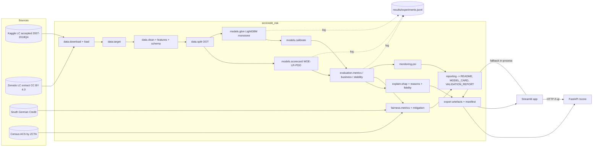

# Credit default prediction: Phase 2 execution plan

**Status:** draft for approval, 2026-11-06. Nothing has been built. **Stop here until you approve.**

**Files in this plan**
- `PLAN.md` (this file): all 15 sections, with the long ones summarised.
- [`RESEARCH_INVENTORY.md`](RESEARCH_INVENTORY.md): Step 0, what existed, contradictions, re-verification.
- [`docs/01_target_audience_signals.md`](docs/01_target_audience_signals.md): interviewer research and the 15 signals.
- [`docs/02_data_plan.md`](docs/02_data_plan.md): §5 in full.
- [`docs/03_roadmap.md`](docs/03_roadmap.md): §6 in full, every task.
- [`docs/04_interview_kit.md`](docs/04_interview_kit.md): §12 in full.
- [`docs/05_learning_path.md`](docs/05_learning_path.md): §13 in full.
- [`docs/SOURCES.md`](docs/SOURCES.md): every link used, with confidence.

**Confidence tags:** High = primary source opened; Medium = secondary or partly readable; Low = blog or aggregator; Unverified = my judgement, to be tested.

## Assumptions (stated, then continued)

1. **Date** = 2026-11-06.
2. **"Original requirements"** = the Phase 1 research report and its handoff block. Where this brief and Phase 1 differ, this brief wins: no time cap, FastAPI is core, and scope is full.
3. **Target roles** = internships in quant research, data science and risk / model-validation / ML engineering at banks, asset managers, quant funds and fintech lenders. Quant trading is included, but the project is only an indirect signal for it (docs/01).
4. **Budget** = free tier only: free Kaggle and Census accounts, GitHub public repo and Actions, Streamlit Community Cloud, Render free.
5. **Compute** = a laptop with ≥16 GB RAM, no GPU (Unverified until E-01 measures it).
6. **Jurisdiction framing** = US for law (Reg B, SR 26-2), with an EU AI Act note. Not legal advice.
7. **Primary data** = the full Lending Club accepted-loans file **if** gate D-01 confirms its licence and access on your machine. Otherwise the CC BY 4.0 Zenodo extract (RESEARCH_INVENTORY C1).

## What changed from Phase 1 (read this first)

- **The Zenodo extract has only 14 columns, with no `term` and no bureau history.** The full file becomes primary (gated), and Zenodo is used for fallback and for a reproduction benchmark.
- **The German Credit "sex" variable is unrecoverable** (UCI says so). The fairness side-study switches to **South German Credit, by age**.
- **The CFPB removed the disparate-impact effects test from Reg B** (final rule 22 Apr 2026, effective 21 Jul 2026, being litigated). The fairness section is re-framed around what still applies.
- **PDO scaling is implemented and tested in-house**, because I could not verify OptBinning's PDO option.

## Signals this project must send (summary of docs/01)

From 13 job postings and career pages (JPMorgan QR Risk, Two Sigma QR and DS, Citadel, Citadel Securities, Jane Street, Goldman Sachs, Capital One, Upstart, Nissan):

| Signal | Delivered by |
|---|---|
| S1 In-depth research on real data · S2 Pre-registered hypotheses · S14 Literature-grounded | §2 pre-registration tag, §7 experiment log, M-02 reproduction of a published AUC |
| S3 Backtesting / out-of-time · S6 Statistical depth | §5 splits, rolling-origin backtest, DeLong + bootstrap CIs, PSI critical values |
| S4 Model soundness and validation reports · S5 Credit models done the lender way | Scorecard with PDO, champion vs challenger, VALIDATION_REPORT on SR 26-2 pillars |
| S7 Clean, tested Python + SQL · S8 Deployment | §4 repo, §9 tests, CI, FastAPI + Streamlit |
| S9 Explainability and fair lending | Reg B reason codes with fidelity and stability tests, fairness audit with dated legal context |
| S10 Business impact · S11 Trade-offs · S12 Honesty · S13 Communication | EL and approval/bad-rate view, "why X not Y" table, §8 protocol, 5 disclosed weaknesses, talk tracks |
| S15 Honest use of AI tools | README "how this was built", interview Q25 |

---------------------------------------------------------------------

## 1. Product definition

**Problem.** A consumer lender has to decide, for each application, whether to approve. It needs a calibrated probability of default (PD), a points score a credit officer can read, and up to four specific reasons for any decline (Reg B, [12 CFR 1002.9](https://www.law.cornell.edu/cfr/text/12/1002.9) · High). It must also show a model-risk reviewer that the model is sound, stable and fair ([SR 26-2](https://www.federalreserve.gov/supervisionreg/srletters/SR2602a1.pdf) · High).

**Users.**
1. **Credit policy analyst:** sets the cutoff from the approval vs bad-rate trade-off.
2. **Model validator:** reads the validation report and the champion/challenger memo.
3. **Applicant (simulated):** receives a decision, a score and plain-language reasons.
4. **Interviewer:** probes any decision.

**MVP (core, above the cut line in docs/03):**
- Out-of-time champion (WOE scorecard with PDO points) vs challenger (monotone LightGBM, calibrated).
- Full metric set with CIs, the imbalance comparison and the business view.
- SHAP plus two reason-code methods, with fidelity and stability tests.
- Fairness audit (LC geographic proxy + South German Credit by age) with mitigation trade-off and legal context.
- PSI monitoring, model card, validation report.
- FastAPI scoring API + Streamlit app, live.

**Stretch (below the cut line):** XGBoost/CatBoost, H-measure, EBM, 60-month segment, 24-month target, reject-inference experiment, survival model, conformal PD intervals, counterfactual recourse.

**Explicit non-goals:**
- Not a claim about today's borrowers (historical platform).
- No Basel capital or IFRS 9 provisioning engine; EL is illustrative.
- No text, LLM or deep-learning features.
- No individual-level race inference (no BISG; the data can't support it).
- No real decisions on real people. The app labels itself a demo.
- No hyperparameter heroics beyond a bounded search.

**60-second demo script.**
1. *(0–10 s)* "This is a bank-style credit decision demo built on [N] Lending Club loans, tested out of time on [year]." The app header shows the model version and its OOT AUC.
2. *(10–25 s)* Pick "Example applicant: thin file, high utilisation" and press **Score**. The card shows: score [s] (band [b]), PD [p]%, **Decline**.
3. *(25–40 s)* Point to the four reasons, e.g. "Revolving utilisation is high relative to approved applicants", "Few years of credit history", and the plain-language paragraph. "These come from the scorecard points, Reg B's method. The tab here shows the SHAP version and how often they agree."
4. *(40–50 s)* Lower utilisation in the form, rescore, and the decision flips to Approve. "The reasons are faithful: changing the top reason moves the score."
5. *(50–60 s)* Open the "Model card" tab: champion vs challenger result with its CI, fairness summary, limitations. "Everything here is generated from the results files, and the success criteria were committed before training."

## 2. Pre-registered success criteria

Committed as `PREREGISTRATION.md` and tagged `prereg-v1` **before any model code** (task P-01). Changing a criterion afterwards requires a dated amendment section explaining why. Results are never promised: the published honest range on LC application-time data is about 0.66–0.73 AUC ([Sanz-Guerrero & Arroyo](https://arxiv.org/html/2401.16458v3) · High; [Qian et al.](https://arxiv.org/pdf/2112.10078) · Medium). That range is context, not a target.

**Models compared:**
- M0 naive (train bad rate)
- M1 incumbent (LC `sub_grade` as a score, benchmark only)
- **M2 champion** (WOE logistic scorecard)
- M3 LightGBM unconstrained
- **M4 challenger** (monotone LightGBM, calibrated)

**Primary metrics** on the OOT test set (2015 vintages), each with a 95% bootstrap CI (2,000 resamples) plus DeLong for AUC:
- AUC / Gini, KS, Brier, log-loss, calibration slope and intercept.
- Secondary: PR-AUC, approval rate vs bad rate, EL per $100 at fixed approval rates.

| ID | Hypothesis / criterion | Minimum threshold (pre-registered) | Basis |
|---|---|---|---|
| C1 | **Pipeline validity:** the champion learns real signal | M2 OOT AUC 95% CI lower bound > 0.60 | Unverified. Set below the published range so it tests the pipeline, not ambition |
| C2 | **Leakage tripwire** | Any OOT AUC > 0.80 → stop and write a leakage audit before reporting anything | Phase 1 inference · Unverified |
| C3 | **Challenger promotion:** M4 replaces M2 only if **all** hold: (a) ΔAUC 95% CI lower bound > 0; (b) point ΔAUC ≥ 0.01 (minimum effect of interest); (c) ΔBrier upper CI ≤ 0.001; (d) monotonicity tests pass; (e) reason-code fidelity ≥ 80%; (f) the equalised-odds gap is not larger than M2's by more than its CI | Unverified judgement. (b) roughly matches the size of gain papers treat as meaningful (Qian et al. report +0.009) |
| C4 | **Calibration:** OOT calibration slope in [0.8, 1.2] and |mean PD − observed bad rate| ≤ 2 pp | Unverified. A failure means "requires recalibration before use", not that the model is invalid |
| C5 | **Stability:** rolling-origin AUC sd ≤ 0.02 across the 3 folds; no OOT quarter with AUC below (OOT AUC − 0.03); score PSI dev→OOT below its simulated 99% critical value | Unverified thresholds. PSI method from [du Pisanie et al.](https://arxiv.org/pdf/2303.01227) · High |
| C6 | **Imbalance arm:** chosen by lowest validation log-loss among arms not significantly worse on AUC; tie → natural mix | Rule, not a result |
| C7 | **Explanation quality:** fidelity ≥ 80%; Kendall's W of top-10 SHAP ranking across 10 seeds reported, with W < 0.7 flagged (Unverified threshold) | |
| C8 | **Incumbent comparison:** report M2/M4 vs M1 either way. No threshold, because LC's grade may use information that is not in the file | |

**What a null or negative result looks like, and how to present it:**
- **C3 fails** (challenger not better): "Champion retained. Boosting's gain of [Δ] AUC (CI [a, b]) did not meet the pre-registered bar, so the added complexity is not justified." This is a **legitimate model-risk outcome** and a strong interview story (S12).
- **C1 fails:** a pipeline or target bug is likely. Debug it, document the bug and the fix in `research/postmortems/`, and rerun from validation only (the test stays untouched until fixed; the lock file records a reset with its reason).
- **C4 fails:** report it, apply recalibration-in-the-large on validation, and state that production would need periodic recalibration (Reg B requires periodic revalidation, [1002.2(p)](https://www.law.cornell.edu/cfr/text/12/1002.2) · High).
- **C5 fails:** a regime-dependence finding. Show the per-vintage table and discuss it. Do not hide quarters.
- **M1 beats both:** "LendingClub's own grade outranks a model using only the public application fields. This bounds what the public data can do." That is an honest, interesting result.

## 3. Architecture



**Data flow.** Raw CSV → `loans_clean.parquet` (validated schema) → split parquets → fitted pipelines (`joblib`) → scores per split → metrics CSVs and figures → reports. Artefacts go to `models/` with a `manifest.json` (hashes), and the API and app read only `models/`.

**Module interfaces** (typed, pure where possible):

| Module | Key functions / classes |
|---|---|
| `data.download` | `download(source) -> Path`; `verify_hash(path, expected) -> None` |
| `data.target` | `build_target(df, cfg: TargetConfig) -> pd.DataFrame` (adds `y`, `exclusion_reason`) |
| `data.clean` / `features` / `schema` | `clean(df) -> df`; `derive(df) -> df`; `LoanSchema` (pandera) |
| `data.split` | `make_splits(df, cfg: SplitConfig) -> dict[str, pd.Index]` |
| `models.scorecard` | `ScorecardModel.fit(X, y)`, `.predict_proba(X)`, `.points(X) -> pd.DataFrame`, `scale_points(log_odds_good, base_score, base_odds, pdo)` |
| `models.gbm` | `fit_lgbm(X, y, params, monotone: dict) -> lgb.LGBMClassifier` |
| `models.calibrate` | `calibrate(model, X_val, y_val, method) -> CalibratedClassifierCV` |
| `evaluation.metrics` | `auc, gini, ks, pr_auc, brier, calibration_table, delong_test, paired_bootstrap(metric, y, s1, s2, n)` |
| `evaluation.business` | `approval_bad_curve(pd, y)`, `expected_loss(pd, lgd, ead)`, `cutoff_for_approval_rate(pd, rate)` |
| `explain.reasons` | `scorecard_reasons(points_row, reference, k=4) -> list[Reason]`; `shap_reasons(shap_row, families, k=4)`; `fidelity_test(model, X, reasons) -> FidelityReport` |
| `fairness.audit` | `fairness_table(y, yhat, pd, groups) -> pd.DataFrame` (wraps Fairlearn `MetricFrame`) |
| `monitoring.psi` | `psi(expected, actual, bins) -> float`; `psi_critical_value(expected_props, n, alpha, sims) -> float` |
| `api.main` | `POST /score(Application) -> ScoreResponse` |

**Why X, not Y:**

| Choice | Chosen | Not chosen | Why | Source · confidence |
|---|---|---|---|---|
| Champion model | WOE logistic scorecard | Plain LR on raw features | Monotone bins handle non-linearity and missingness; points are readable; this is industry standard | [OptBinning](https://github.com/guillermo-navas-palencia/optbinning) · Medium; [Lessmann](https://crc.business-school.ed.ac.uk/sites/crc/files/2023-10/Benchmarking-State-of-the-Art-Classification-Algorithms-for-Credit-Scoring-Lessmann-Seow-Baesens-and-Thomas.pdf) · High |
| Challenger | LightGBM | XGBoost / CatBoost / deep nets | Fast on 1M rows on CPU, native NaN, monotone constraints with less-restrictive methods. CatBoost ranks first on TabArena, so it is stretch S-01. Deep nets are not worth it on tabular data | [LightGBM](https://lightgbm.readthedocs.io/en/latest/Parameters.html) · High; [TabArena](https://arxiv.org/pdf/2506.16791) · High; [Grinsztajn](https://arxiv.org/abs/2207.08815) · High |
| Imbalance | Natural mix + cutoff (expected; decided by rule C6) | SMOTE by default | Resampling miscalibrates PDs | [van den Goorbergh](https://arxiv.org/abs/2202.09101v1) · High |
| Calibration | sigmoid or isotonic via `FrozenEstimator`, cross-fit on validation | Calibrating on train | Disjoint data required. Sigmoid preserves ranking | [scikit-learn](https://scikit-learn.org/stable/modules/calibration.html) · High |
| Explanations | TreeSHAP interventional, log-odds | LIME, tree_path_dependent | Exact additivity. Interventional supports a background distribution | [SHAP docs](https://shap.readthedocs.io/en/latest/generated/shap.TreeExplainer.html) · High; [FinRegLab](https://finreglab.org/wp-content/uploads/2023/07/FRL-ML-EWP_July2023.pdf) · High |
| Fairness lib | Fairlearn 0.15 | AIF360 | Smaller API, scikit-learn native, reductions + ThresholdOptimizer | [Fairlearn](https://fairlearn.org/main/user_guide/assessment/common_fairness_metrics.html) · High; AIF360 comparison Unverified |
| Drift | PSI with simulated critical values | PSI with 0.1/0.25 only | Rules of thumb are not statistical | [du Pisanie](https://arxiv.org/pdf/2303.01227) · High |
| Env manager | uv + `uv.lock` | conda, pip-tools | One fast tool, lockfile, Python pinning | Unverified (tool docs not opened) |
| Config | YAML validated by pydantic models | Hydra | One pipeline doesn't need composition or sweeps. Pydantic gives type errors early | Unverified judgement |
| Experiment log | Append-only `results/experiments.jsonl` | MLflow server | Diffable in git, free, no server. MLflow is overkill for one person | Unverified judgement |
| Data validation | pandera | Great Expectations | Schemas in Python next to the code, lightweight | Unverified judgement |
| Storage / SQL | parquet + DuckDB | Postgres | Zero-ops, shows SQL (S7) | Unverified judgement |
| API | FastAPI + pydantic | Flask | Typed request validation, auto OpenAPI docs | Unverified judgement |
| UI | Streamlit Community Cloud | Gradio on HF Spaces | HF Gradio/Docker Spaces now need a paid plan to create | [HF Spaces](https://huggingface.co/docs/hub/en/spaces-overview) · High |
| API host | Render free (Docker) | Fly.io, Cloud Run | Free tier verified (512 MB, sleeps after 15 min). Others not checked | [Render](https://render.com/docs/free) · High |

## 4. Repository blueprint

```
credit-risk-scorecard/
├── README.md                    # §11 outline; numbers auto-filled by `make report`
├── MODEL_CARD.md                # Mitchell et al. sections + SR 26-2 items (generated from template)
├── VALIDATION_REPORT.md         # conceptual soundness / outcomes analysis / ongoing monitoring
├── PREREGISTRATION.md           # §2, frozen at tag prereg-v1
├── LICENSE                      # MIT for code; data licences listed in data/README.md
├── pyproject.toml  uv.lock  .python-version (3.12)
├── Makefile                     # setup data features train evaluate explain fairness monitor report api app test lint final
├── .pre-commit-config.yaml      # ruff, mypy, large-file guard
├── .github/workflows/ci.yml     # lint + type check + fast tests on push/PR
├── .github/workflows/slow.yml   # manual: full pipeline on a 5% sample
├── configs/
│   ├── base.yaml                # paths, seeds (global_seed: 42), data source
│   ├── target.yaml              # status mapping, term, vintage bounds
│   ├── splits.yaml              # dev/valid/test/monitor boundaries
│   ├── features.yaml            # whitelist + exclusion reasons
│   ├── monotone.yaml            # LightGBM constraint directions
│   ├── scorecard.yaml           # binning params, PDO (600, 50, 20)
│   ├── reason_text.yaml         # feature/family → plain-English reason
│   └── business.yaml            # LGD source, margin sensitivity grid, approval rates
├── data/README.md               # how to download; raw/ interim/ processed/ are git-ignored
├── sql/vintage_bad_rate.sql     # DuckDB queries for profile tables
├── src/credit_risk/
│   ├── config.py                # pydantic models loading configs/*.yaml
│   ├── seed.py                  # set_all_seeds(seed) for numpy/random/lightgbm
│   ├── data/{download,target,clean,features,schema,split}.py
│   ├── models/{baselines,scorecard,gbm,calibrate,imbalance}.py
│   ├── evaluation/{metrics,business,stability,compare}.py
│   ├── explain/{shap_global,reasons,fidelity,stability}.py
│   ├── fairness/{proxy,audit,mitigate}.py
│   ├── monitoring/psi.py
│   ├── reporting/{figures,tables,render}.py   # Jinja templates → MD
│   ├── export.py                # artefacts + manifest.json
│   └── log.py                   # experiment-log writer (schema §7)
├── api/main.py  api/schemas.py  api/Dockerfile
├── app/streamlit_app.py  app/requirements.txt (pinned, generated by uv export)
├── models/                      # small artefacts + manifest.json (committed, < 50 MB)
├── results/                     # experiments.jsonl, *_metrics.csv, final.lock (committed)
├── reports/                     # figures/*.png, binning/*.csv, *.md (committed)
├── research/                    # Phase 0 notes, decisions, licence evidence, postmortems
├── notebooks/                   # thin, exploratory only; import from src/
├── scripts/                     # smoke_env.py, check_prereg.py, check_readme_numbers.py
└── tests/
    ├── unit/                    # T-01…T-14
    ├── synthetic/               # T-05 known-answer test
    ├── regression/              # golden results with tolerances
    └── api/                     # FastAPI TestClient tests
```

- **Pinned environment:** Python 3.12 via `.python-version`. All dependencies are locked in `uv.lock`. The app's `requirements.txt` is exported from the lock. Versions as of today are in RESEARCH_INVENTORY V3; E-01 confirms they work together.
- **Seeds:** a single `global_seed` in `configs/base.yaml`. `set_all_seeds()` is called at every entry point. LightGBM uses `seed`, `deterministic=True` and `force_row_wise=True` (the LightGBM docs require one of the force options when deterministic is set · High). Bootstrap streams use `np.random.default_rng(seed + k)`.
- **Make targets** run the whole pipeline end to end. `make final` is the only target that touches the test set.
- **CI:** on every push, ruff, mypy, and pytest excluding slow tests (synthetic + unit + API) must pass. A manual `slow.yml` runs the full pipeline on a 5% stratified sample. Free on public repos ([GitHub](https://docs.github.com/en/billing/concepts/product-billing/github-actions) · High).

## 5. Data plan (summary; full version in [docs/02_data_plan.md](docs/02_data_plan.md))

- **Sources:**
  - Primary: full LC accepted file (Kaggle, licence gate D-01, **Unverified**).
  - Fallback and benchmark: Zenodo extract (CC BY 4.0, md5-checked, **High**).
  - Fairness side-study: South German Credit (CC BY 4.0, **High**).
  - Proxy groups: Census ACS (spike F-01).
- **Target:** bad = Charged Off / Default (incl. "does not meet credit policy" charge-offs); good = Fully Paid. **Population:** individual 36-month loans issued 2007-06 → 2015-12. **Observation window:** issue → contractual maturity, all matured by the 2018Q4 snapshot. Indeterminate statuses are excluded, counted and given a sensitivity analysis.
- **Features:** a ~22-column application-time whitelist (FICO, DTI, income, utilisation, inquiries, delinquencies, credit age…). `grade`/`sub_grade`/`int_rate`/`installment` are incumbent-only. ZIP/state are for fairness auditing only.
- **Splits:** train 2007–2013, validation 2014, OOT test 2015 (once), monitoring 2016–2018 (unlabelled). Plus a 3-fold rolling-origin backtest, per-quarter metrics and adversarial validation.
- **Leakage checklist:** L1–L9. **Bias checklist:** B1–B7 (selection, survivorship, regime, self-report, proxy, label, ZIP-as-proxy).

## 6. Phased roadmap (summary; every task in [docs/03_roadmap.md](docs/03_roadmap.md))

| Phase | Entry → exit | Tasks |
|---|---|---|
| 0 Environment and gates | Plan approved → env locked, licence decided, CI green, pre-registration tagged | E-01★ E-02 D-01★ P-01★ |
| 1 Data | D-01 decided → validated parquet, whitelist enforced, splits frozen | D-02★ D-03★ D-04★ D-05 D-06 |
| 2 Champion | Splits frozen → scorecard with PDO, hand-checked example | M-01★ M-02 M-03★ M-04★ M-05★ |
| 3 Challenger | Champion done → calibrated challenger, imbalance arm chosen | M-06★ M-07 M-08★ M-09★ |
| 4 Evaluation | Candidates frozen → OOT metrics with CIs, business view, stability | EV-01★ EV-02★ EV-03 EV-04 |
| 5 Explainability | OOT done → reasons (2 methods), fidelity, stability | X-01 X-02★ X-03★ X-04 X-05 |
| 6 Fairness | Reasons done → metrics, mitigation trade-off, legal page | F-01 F-02★ F-03 F-04 |
| 7 Model risk | Results final → decision memo, PSI monitoring, reject-inference section | MR-01★ MR-02 MR-03 |
| 8 Deployment | Decision made → API + app live with fallback | DEP-01★ DEP-02★ DEP-03★ DEP-04 |
| 9 Docs | App live → README, model card, validation report, kit with real numbers, `v1.0` | DOC-01★…DOC-06, FINAL★ |
| ✂ **Cut line** | | Stretch S-01…S-09 only after `v1.0` |

★ = critical path. M-02, D-05, F-01, F-04 and MR-03 can run in parallel with the critical path.

## 7. Method plan

**Baselines first:** M0 naive → M1 LC incumbent → M2 champion scorecard. Then the challengers: M3 unconstrained LightGBM → M4 monotone LightGBM → calibration → imbalance arms. Stretch: S-01 CatBoost/XGBoost, S-03 EBM.

**Scorecard maths (for the PDO derivation in interviews):** with odds = good:bad, `score = offset + factor·ln(odds)`, `factor = PDO/ln 2`, `offset = base_score − factor·ln(base_odds)`. With 600 at 50:1 and PDO 20: factor ≈ 28.85, offset ≈ 487.1. A score of 620 means odds of 100:1. Per-attribute points: `points_ij = −(β_j·WOE_ij + β_0/k)·factor + offset/k` for k features (the sign depends on the WOE convention; test T-08 pins it).

**Ablations** (each a logged run on validation; OOT only for the final pair):

| ID | Ablation | Question it answers |
|---|---|---|
| A-01 | M4 without bureau features (FICO, inquiries, delinquencies) | How much signal is in the bureau data vs the application? |
| A-02 | M4 monotone vs M3 unconstrained; `basic` vs `intermediate` vs `advanced` | What does interpretability cost in AUC? |
| A-03 | Scorecard with max 5 vs 10 vs 20 bins | Granularity vs stability |
| A-04 | Drop "does not meet credit policy" loans | Does the 2007–2010 policy population matter? |
| A-05 | Add LC `sub_grade` as a feature (diagnostic only, never deployed) | How much does LC's own model know beyond the public fields? |
| A-06 | Isotonic vs sigmoid calibration | Calibration gain vs ranking ties |
| A-07 | Remove one reason family at a time | Which families drive performance, cross-checked with SHAP |

**Sensitivity analyses:**

| ID | Analysis |
|---|---|
| SA-01 | Indeterminate loans treated as bad, then as good |
| SA-02 | Bootstrap on the cutoff: how stable is the approval/bad-rate trade-off? |
| SA-03 | Train on 2010+ only (excludes crisis vintages) |
| SA-04 | Without policy-exception loans (= A-04, reported on OOT as well) |
| SA-05 | Business view across margin m ∈ {0.05, 0.10, 0.15} and LGD ± 10 pp (Unverified values) |
| SA-06 | Fairness metrics at 3 cutoffs, not just one |

**Experiment log schema** (`results/experiments.jsonl`, one JSON object per run, written by `log.py`, validated by pydantic):

```json
{"run_id": "2026-xx-xxTxx:xx:xxZ_m4_a02_intermediate", "git_sha": "abc1234", "config_hash": "sha256:…",
 "data_hash": "sha256:…", "stage": "validation|oot|backtest_fold_k", "model": "M4", "arm": "A",
 "ablation": "A-02", "params": {"num_leaves": 31, "monotone_method": "intermediate"},
 "seed": 42, "n_train": 0, "n_eval": 0, "bad_rate_eval": 0.0,
 "metrics": {"auc": 0.0, "auc_ci": [0.0, 0.0], "ks": 0.0, "gini": 0.0, "pr_auc": 0.0, "brier": 0.0,
             "log_loss": 0.0, "cal_slope": 0.0, "cal_intercept": 0.0},
 "artefacts": ["reports/figures/calib_m4.png"], "duration_s": 0.0, "notes": "free text", "prereg_tag": "prereg-v1"}
```

The zeros are placeholders for the schema only.

## 8. Honesty and robustness protocol

**Ten ways this project could fool me, and the test that catches each:**

| # | Failure mode | Catching test |
|---|---|---|
| 1 | Post-origination leakage inflates AUC | T-01 whitelist and regex test in CI; C2 tripwire at 0.80; missingness-by-target audit |
| 2 | Random or overlapping splits | T-02 date-order assertion; rolling-origin backtest |
| 3 | Peeking at the test set repeatedly | `final.lock` with config hash; test evaluation only in `make final`; git history shows one final run |
| 4 | Moving the goalposts after seeing results | `prereg-v1` tag predates model code (CI `check_prereg.py`); amendments dated |
| 5 | Right-censored labels (immature loans counted as good) | Maturity rule; indeterminate counts per vintage; SA-01 |
| 6 | A "gain" that is noise | DeLong + paired bootstrap CIs; minimum effect of interest; rolling-origin sd |
| 7 | Good ranking, wrong PDs | Calibration slope/intercept, Brier, per-band predicted vs observed (C4) |
| 8 | Explanations that don't reflect the model | Fidelity test (X-03); SHAP additivity test; LR-SHAP = centred contribution test (T-13) |
| 9 | Unstable explanations presented as facts | 10-seed Kendall's W and reason-set Jaccard (X-04) |
| 10 | Fairness numbers that mean less than they seem (proxy, small n) | CIs on every group metric; "proxy" labels everywhere; results at 3 cutoffs; age analysis on a dataset with real age |

Also: **code that is right by accident.** T-05 synthetic known-answer test, plus a hand-computed scorecard example.

**Finance-awareness items (each goes into the model card or validation report):**
- **Costs:** a false accept costs about LGD × EAD; a false decline costs the lost margin. The cutoff comes from EL/profit, not from accuracy. Margin and LGD assumptions are sensitivity-tested (SA-05).
- **Regimes:** the 2007–2009 crisis, P2P growth, LC policy changes, and the end of retail notes in 2020 ([Nasdaq](https://www.nasdaq.com/articles/lendingclub-is-ending-its-p2p-lending-platform-now-what-2020-10-08) · Medium). Per-vintage metrics and SA-03.
- **Regulation (dated 2026-11-06):**
  - Reg B adverse-action reasons ([1002.9](https://www.law.cornell.edu/cfr/text/12/1002.9) · High).
  - Prohibited bases ([1002.2(z)](https://www.law.cornell.edu/cfr/text/12/1002.2) · High).
  - The effects test removed from Reg B, effective 21 Jul 2026, under challenge ([Venable](https://www.venable.com/insights/publications/2026/05/cfpb-makes-significant-changes-to-regulation-b) · Medium; [CFM](https://www.consumerfinancemonitor.com/2026/08/10/lawsuit-challenging-cfpbs-revised-ecoa-rule-moves-forward-under-lengthy-summary-judgment-schedule/) · Medium).
  - SR 26-2 ([Fed](https://www.federalreserve.gov/supervisionreg/srletters/sr2602.htm) · High).
  - EU AI Act Annex III from 2 Dec 2027 ([Mondaq](https://www.mondaq.com/eu-digital-omnibus-on-ai-enters-into-force/1825722) · Medium).
- **Model risk:**
  - Materiality: a consumer underwriting model would be high-materiality (Unverified for any specific bank).
  - Champion/challenger maps to SR 26-2's "comparison of alternative assumptions and methodologies" and "benchmarking to other models" (High; SR 26-2 does not use the word "challenger").
  - Validation is independent in a bank. Here, the disclosed weakness is that it is self-validated.
- **Capacity and data quality:**
  - Self-reported income.
  - Charge-off ≠ Basel default.
  - No rejects (selection bias; reject-inference section).
  - Monitoring outcomes lag by a full term, so production monitoring relies on input PSI and early-delinquency proxies that this dataset cannot supply.

## 9. Test strategy

Unit tests for silent-bug-prone functions (pytest; property tests with hypothesis):

| ID | What | Why it is silent-bug-prone |
|---|---|---|
| T-01 | Feature whitelist / leakage regex on the final `X` | A merge or a rename can quietly add a leaking column |
| T-02 | Split dates strictly ordered, no ID overlap | Off-by-one month boundaries |
| T-03 | Binning fitted on train only (perturbing validation rows doesn't move bin edges) | sklearn pipelines fitted on the wrong frame |
| T-04 | `credit_age_months` from hand-made rows (incl. Feb/leap years, bad parses) | Date arithmetic |
| T-06 | Status mapping is exhaustive; an unknown status raises | A new status silently becomes good |
| T-07 | WOE monotone per selected feature | Binning settings regress |
| T-08 | PDO property: +PDO points doubles the odds; points sum to the total; hand example matches | Sign conventions |
| T-09 | Monotone constraint honoured on a grid | Wrong feature order in the `monotone_constraints` list (LightGBM requires all features in order) |
| T-10 | `ks()` equals `ks_2samp` statistic and max(TPR−FPR) on random data | Off-by-one at ties |
| T-11 | AUC invariant to monotone transforms; Gini = 2·AUC−1; M0 AUC = 0.5 | Score orientation flipped (1 − AUC) |
| T-12 | PSI = 0 for identical samples; detects an injected shift; handles empty bins (epsilon) | Division by zero / log(0) |
| T-13 | For LR on independent features, SHAP_j = β_j(x_j − E[x_j]) | Explainer setup or background mistakes |
| T-14 | Exported artefacts reproduce stored scores bit-for-bit | Serialisation and version drift |
| T-15 | Every number in the README matches `results/*.csv` | Hand-typed, stale numbers |

**Synthetic-data test with a known answer (T-05, `tests/synthetic/`):**
- Generate 200k rows: x1 ~ N(0,1), x2 ~ N(0,1), x3 ~ Bernoulli(0.3), plus a pure-noise column.
- True logit = −2 + 0.8·x1 − 0.5·x2 + 0.7·x3, y ~ Bernoulli(sigmoid(logit)).
- Assert:
  1. Plain LR recovers the coefficients within ±0.05.
  2. The scorecard's OOT AUC is within 0.01 of the **Bayes AUC** computed from the true probabilities.
  3. The noise column's IV < 0.02 and it is dropped.
  4. The calibration slope of LR is in [0.95, 1.05].
  5. LightGBM monotone +1 on x1 shows no violations.
  6. A known closed form: for two Gaussians N(0,1) vs N(1,1), AUC = Φ(1/√2) ≈ 0.760 and KS = 2Φ(0.5) − 1 ≈ 0.383, and `metrics.py` matches both within 0.005 on 200k draws.
  7. Fidelity: perturbing x1 moves PD more than perturbing the noise column in ≥ 99% of rows.

**Regression tests on results (`tests/regression/`):**
- After v1.0, `golden_metrics.json` stores OOT AUC/KS/Brier for M2 and M4 plus the scores of 100 fixed rows.
- CI (slow job) reruns on the 5% sample and asserts the metrics are within ±0.005 of their golden sample values and the scores match within 1e-9.
- Any intentional change requires updating the golden file in a commit whose message says why.

## 10. Deployment

**Stack:** FastAPI (Docker) on Render free; Streamlit app on Streamlit Community Cloud; artefacts committed in `models/` (< 50 MB).

**Step by step:**
1. `make export` writes `models/*` + `manifest.json` (DEP-01).
2. `docker build -f api/Dockerfile -t credit-api .`, then `docker run -p 8000:8000 credit-api`, then `pytest tests/api` against the container.
3. Render: New Web Service → connect the GitHub repo → runtime Docker → Dockerfile path `api/Dockerfile` → health check path `/health` → env var `MODEL_DIR=/app/models` → deploy. Record the URL.
4. Streamlit Community Cloud: New app → repo, branch `main`, file `app/streamlit_app.py` → secrets `API_URL=<render url>` → deploy.
5. Add both URLs and a status badge to the README. Record a GIF of the demo script as the offline fallback.
6. Post-deploy smoke test: `scripts/smoke_live.py` posts the example applicant to the live API and checks that the schema and model_version match the manifest.

**Free-tier limits** (verified 2026-11-06):
- **Render free:** 512 MB RAM; spins down after 15 min idle; cold start "about one minute"; 750 instance hours/month; ephemeral disk ([docs](https://render.com/docs/free), [pricing](https://render.com/pricing) · High).
- **Streamlit Community Cloud:** 0.078–2 cores, 690 MB–2.7 GB RAM, sleeps after 12 h without traffic ([docs](https://docs.streamlit.io/deploy/streamlit-community-cloud/manage-your-app) · High).

**Fallbacks:**
1. The app calls the API with a 3 s timeout. If it is cold or down, the app scores **in-process** from the same artefacts and shows a small "API waking up; scored locally (same model, version X)" note.
2. If Streamlit is asleep, the README GIF and screenshots show the flow.
3. If memory is too tight, drop the SHAP background from 500 to 100 rows and serve the champion only.

**What the live app shows:**
- An input form (12–15 whitelisted fields with valid ranges) and example applicants.
- **Score**, band, **PD**, decision at the policy cutoff, **up to 4 reasons** (scorecard method, with SHAP as a toggle), and a **plain-language paragraph** generated from a template. The template is not an LLM, so the text is deterministic and auditable.
- A points breakdown table.
- Tabs: model card summary, fairness summary, limitations, and "about the data". The footer says: demo only, not a credit decision.

## 11. Documentation

**README outline:**
1. One-line result with OOT numbers and CIs, plus the live links.
2. 60-second GIF.
3. Problem and users.
4. Data: source, licence, target definition diagram, exclusions.
5. Method: splits, champion, challenger, calibration, imbalance decision.
6. Results table + three figures (calibration, approval vs bad rate, AUC by vintage).
7. Explainability: reason-code example, fidelity and stability.
8. Fairness: metrics, trade-off, legal context (dated).
9. Model risk: link to the validation report, PSI.
10. **Limitations.**
11. Reproduce: `make setup data train evaluate report`.
12. Pre-registration link.
13. How this was built: tools, including AI assistance, and what was hand-verified.
14. Licence and citations.

**Model card:** Mitchell et al. sections ([Model Cards](https://arxiv.org/pdf/1810.03993) · High): details, intended use, factors, metrics, evaluation data, training data, quantitative analyses, ethical considerations, caveats. Plus SR 26-2 items: purpose, materiality assumption, limitations, monitoring plan, and owner/validator (self, disclosed).

**Validation report (SR 26-2 pillars):**
1. Conceptual soundness: data, target, feature rationale, binning, benchmarks, interpretability measures.
2. Outcomes analysis: OOT, back-testing by score band, champion vs challenger.
3. Ongoing monitoring: PSI, thresholds, recalibration triggers, Reg B revalidation.
4. Findings and limitations.

**Limitations section:** the 5 weaknesses in §12 plus the B1–B7 biases.

**Results tables and figures:**
- **Tables:** OOT metrics table; rolling-origin table; imbalance arms; ablations; fairness table; PSI table.
- **Figures:** ROC + KS plot; calibration (before/after); approval vs bad-rate curve; EL by cutoff; AUC by quarter; SHAP beeswarm vs IV bar chart; reason agreement heatmap; fairness trade-off; PSI by feature.

**Optional blog post outline:** "What a bank would ask about your credit model":
1. Leakage traps.
2. Why out-of-time.
3. The scorecard in 5 minutes.
4. Did boosting earn its complexity?
5. Testing your explanations.
6. Fairness when you don't have the attribute.
7. What I'd do with real bank data.

## 12. Interview kit (summary; full version in [docs/04_interview_kit.md](docs/04_interview_kit.md))

- 3 CV bullet templates with blanks (plus a null-result variant).
- 25 probing questions with answer outlines, grouped: data and target, validation, imbalance, scorecard, explainability, fairness and regulation, model risk and process.
- 5 weaknesses to disclose: charge-off target, selection bias, historical platform, proxy fairness groups, single-snapshot outcome.
- 3-minute and 10-minute talk tracks.

## 13. Learning path (summary; full version in [docs/05_learning_path.md](docs/05_learning_path.md))

22 concepts in roadmap order. Each has primary resources (Basel CRE36, ISL/ESL, Molnar, scikit-learn and LightGBM docs, Lundberg & Lee, van den Goorbergh, Lessmann, du Pisanie, Reg B, Barocas–Hardt–Narayanan, Gillis et al., SR 26-2, Kozodoi) and a self-check exercise, e.g. "derive factor and offset for 600 at 50:1, PDO 20; score at 25:1 = 580".

## 14. Risk register (top 10)

| # | Risk | Early-warning sign | Mitigation | Fallback |
|---|---|---|---|---|
| R1 | Kaggle licence unclear or download blocked | D-01 screenshot shows no licence, or a restrictive one | Decide at D-01, before any work depends on it | Zenodo primary (§5.3b); narrower features disclosed |
| R2 | Hidden leakage | Validation AUC > 0.78, or one feature with IV > 0.5 | Whitelist, T-01, missingness audit, adversarial validation | C2 halt, audit write-up, remove the feature |
| R3 | Library incompatibility (optbinning × pandas 3 / numpy 2.5) | E-01 smoke test fails | Pin versions in E-01 | Pin pandas < 3; or a hand-rolled WOE binning (≈100 lines + tests) |
| R4 | Memory or time on 2M rows | E-01 timing, swap usage | Read `usecols`, set categorical dtypes, use parquet, use DuckDB for aggregations | Develop on a 20% stratified-by-vintage sample; final run on the full data |
| R5 | Challenger not better (null result) | Validation ΔAUC CI includes 0 | None needed: pre-registered | Present as "champion retained" (§2) |
| R6 | Fairness proxy join fails or groups are too small | F-01 coverage < 95%, or group n < 1,000 | State-level grouping | South German Credit age only; explain why |
| R7 | Free hosting sleeps or OOMs during an interview | Cold start > 60 s; Render logs show OOM | Small artefacts; in-process fallback | GIF + screenshots in the README; run locally during the interview |
| R8 | Regulatory facts change (the Reg B lawsuit decides; EU dates move) | Briefing ends 12 Jan 2027; news | Every legal claim dated, in one file (F-04) | Re-verify before each application round; update the dated note |
| R9 | Scope creep into stretch work before v1.0 | Stretch branches exist before DEP-04 | The cut line in docs/03; v1.0 checklist | Freeze stretch until `v1.0` is tagged |
| R10 | Unstable reason codes | X-04 Jaccard of reason sets across seeds is low | Reason families; fewer, coarser bins | Use scorecard reasons as primary in the app; report the SHAP instability as a finding |

## 15. Execution brief (paste into the build prompt)

1. Build a bank-style credit default package: WOE logistic scorecard (champion, PDO 20 at 600 = 50:1) vs monotone LightGBM (challenger, calibrated), on Lending Club, in Python 3.12 with uv, a `src/` package, pytest and CI.
2. Data: full LC accepted file if licence gate D-01 passes, else the Zenodo CC BY 4.0 extract. Never commit raw data. Hash-check downloads.
3. Target: individual 36-month loans issued 2007-06→2015-12. Bad = Charged Off/Default, good = Fully Paid, other statuses excluded and counted.
4. Features: application-time whitelist only (configs/features.yaml), enforced by a CI test. grade/int_rate are incumbent-only; ZIP/state are fairness-only.
5. Splits: train ≤2013, validation 2014, OOT test 2015 used once via `make final`, monitoring 2016–2018 unlabelled. Plus a 3-fold rolling-origin backtest.
6. Commit PREREGISTRATION.md (PLAN §2) and tag `prereg-v1` before any model code. Log every run to results/experiments.jsonl.
7. Compare imbalance arms (natural+cutoff, weights+recal, undersampling+recal, SMOTENC+recal) and pick by validation log-loss. Report AUC, Gini, KS, PR-AUC, Brier, calibration, DeLong and bootstrap CIs, approval vs bad rate, EL.
8. Explain with TreeSHAP (interventional, log-odds) and Reg B reason codes from scorecard points and from SHAP (≤4, grouped families). Test fidelity and seed stability.
9. Fairness: Fairlearn metrics on an LC geographic proxy and South German Credit by age, a mitigation trade-off, and a dated legal note (2026 Reg B change). PSI monitoring with simulated critical values. Model card + SR 26-2 validation report.
10. Deploy FastAPI (/score → PD, score, decision, 4 reasons, explanation) on Render free and Streamlit on Community Cloud with in-process fallback. Follow docs/03 task order, stop at the cut line until v1.0.
